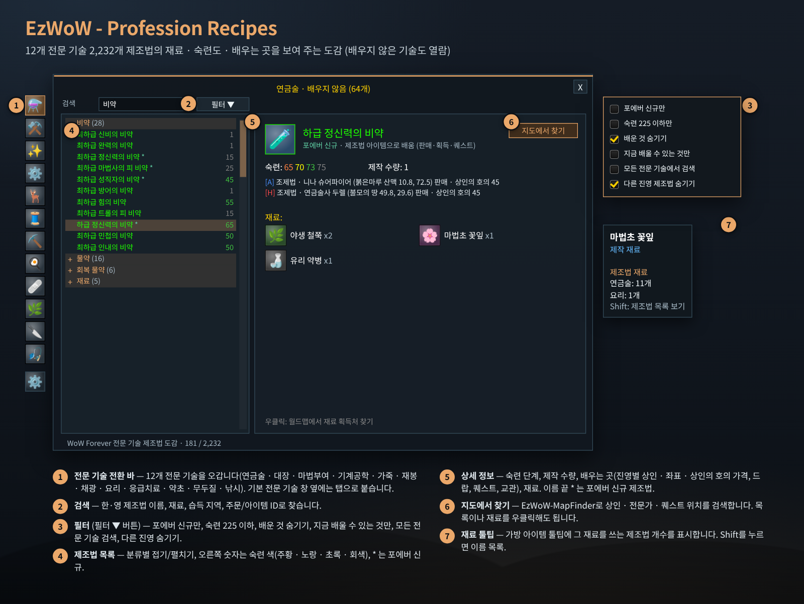
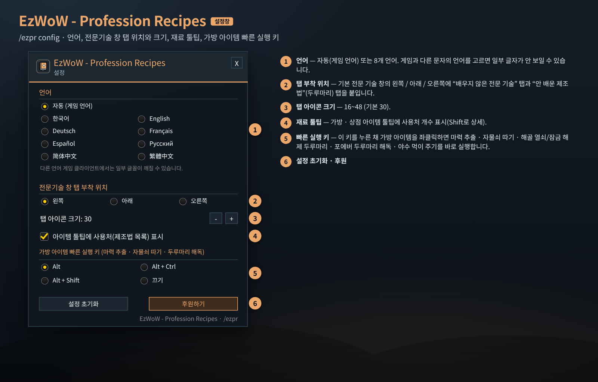
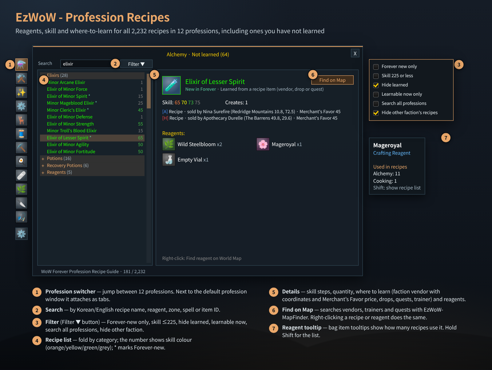

# EzWoW - Profession Recipes (`EzWoW-ProfessionRecipes`)

## CurseForge

- **Project ID / 프로젝트 ID:** `1729781`
- **Project page / 프로젝트 페이지:** [EzWoW-ProfessionRecipes](https://www.curseforge.com/wow/addons/allprofessionrecipes)

**[한국어](#한국어) · [English](#english)**

WoW Forever (`Interface: 16001`) · `/ezpr`

---

## 한국어

### 개요

**12개 전문 기술, 2,232개 제조법**(야영 제조법 포함)의 재료 · 필요 숙련도 · 배우는 곳을 보여 주는 도감입니다. 전문 기술 창 옆에 **배우지 않은 전문 기술 탭**과 **안 배운 제조법 탭**을 붙여 주고, 전문 기술이 하나도 없어도 `/ezpr`로 단독 창을 열어 볼 수 있습니다. 가방 아이템을 보조키 + 클릭 한 번으로 마력 추출 · 자물쇠 따기 · 두루마리 해독하는 기능도 있습니다.

전문 기술: 연금술 · 대장기술 · 마법부여 · 기계공학 · 가죽세공 · 재봉술 · 채광(제련) · 요리 · 응급치료 · 약초 채집 · 무두질 · 낚시(야영 설비)

### 화면 미리보기

> 이미지는 애드온 코드의 창 크기·좌표·색상·문구와 내장 제조법 데이터(연금술)로 재현한 **예시 화면**입니다.

### 설치

1. `EzWoW-ProfessionRecipes` 폴더를 `Interface/AddOns/` 폴더에 넣습니다.
2. 캐릭터 선택 화면의 **애드온** 목록에서 켭니다.
3. 전문 기술 창을 열면 옆에 탭이 붙습니다. 단독 창은 `/ezpr`.

### 사용법 (위 그림의 번호)

| 번호 | 부분 | 설명 |
|---|---|---|
| ① | 전문 기술 전환 바 / 탭 | 단독 창에서는 왼쪽 아이콘으로 12개 전문 기술을 오갑니다. 기본 전문 기술 창을 열면 같은 탭이 창 옆(왼쪽·아래·오른쪽 선택)에 붙고, **두루마리 아이콘 탭**은 지금 열린 전문 기술에서 **아직 배우지 않은 제조법**만 모아 보여 줍니다. |
| ② | 검색 | 한·영 제조법 이름, 재료 이름, 배우는 지역, 주문/아이템 ID로 찾습니다. |
| ③ | 필터 ▼ | 포에버 신규만 · 숙련 225 이하만 · 배운 것 숨기기 · 지금 배울 수 있는 것만 · 모든 전문 기술에서 검색 · 다른 진영 제조법 숨기기 |
| ④ | 제조법 목록 | 분류별로 접고 펼칩니다. 오른쪽 숫자는 필요 숙련도이며 내 숙련 기준 색(빨강 배울 수 없음 · 주황 · 노랑 · 초록 · 회색)으로 표시됩니다. 이름 뒤 `*`는 포에버 신규 제조법입니다. |
| ⑤ | 상세 정보 | 숙련 단계(주황/노랑/초록/회색), 제작 수량, 배우는 곳(교관, 진영별 판매 상인과 좌표 · 상인의 호의 가격, 드랍 지역, 퀘스트), 재료와 개수. |
| ⑥ | 지도에서 찾기 | `EzWoW-MapFinder`로 도안 판매 상인 · 전문가 · 퀘스트 · 획득처를 월드맵에서 찾습니다. 목록의 제조법이나 재료를 **우클릭**해도 같습니다. |
| ⑦ | 재료 툴팁 | 가방·상점 아이템 툴팁에 그 재료가 쓰이는 제조법 수를 전문 기술별로 표시합니다. **Shift**를 누르면 제조법 이름과 숙련도 목록이 나옵니다. |

#### 원클릭 아이템 실행 (기본 `Alt`)

가방 아이템 위에서 보조키를 누른 채 **좌클릭**하면 바로 실행합니다.

- **마력 추출** (마법부여)
- **자물쇠 따기** (도적 — 내 가방 상자, 거래창 아래 칸 상자)
- **대장기술 해골 열쇠 · 카드가의 잠금 해제 두루마리** 사용
- **포에버 두루마리 해독**
- **사냥꾼 야수 먹이 주기**

보조키는 설정창에서 `Alt` / `Alt + Ctrl` / `Alt + Shift` / `끄기` 중에서 고릅니다.

### 설정창 (`/ezpr config`)

| 번호 | 항목 | 설명 | 기본값 |
|---|---|---|---|
| ① | 언어 | 자동(게임 언어) 또는 8개 언어. 게임과 다른 문자의 언어를 고르면 일부 글자가 깨질 수 있습니다. | 자동 |
| ② | 전문기술 창 탭 부착 위치 | 왼쪽 / 아래 / 오른쪽 | 왼쪽 |
| ③ | 탭 아이콘 크기 | 16~48 | 30 |
| ④ | 아이템 툴팁에 사용처(제조법 목록) 표시 | 재료 툴팁 | 켬 |
| ⑤ | 가방 아이템 빠른 실행 키 | Alt / Alt + Ctrl / Alt + Shift / 끄기 | Alt |
| ⑥ | 설정 초기화 · 후원하기 | 모든 설정을 처음으로 되돌립니다. | - |

필터 기본값: 배운 것 숨기기 켬, 다른 진영 제조법 숨기기 켬, 나머지 끔.

### 명령어 (`/ezpr`, `/apr`, `/제조법`, `/전문기술`)

| 명령어 | 설명 |
|---|---|
| `/ezpr` | 단독 제조법 창 열기/닫기 |
| `/ezpr config` (`설정`) | 설정창 |
| `/ezpr side` · `bottom` · `left` | 탭 부착 위치 오른쪽 · 아래 · 왼쪽 |
| `/ezpr icon 16~48` | 탭 아이콘 크기 |
| `/ezpr quick <alt\|ctrl\|shift\|off>` | 빠른 실행 보조키 (`ctrl` = Alt+Ctrl, `shift` = Alt+Shift) |
| `/ezpr lang <auto\|ko\|en\|de\|fr\|es\|ru\|cn\|tw>` | 표시 언어 변경 |
| `/ezpr reset` | 모든 설정 초기화 |
| `/ezpr help` | 도움말 |

### 저장 데이터

- `EzWoW_ProfessionRecipesDB`: 설정, 필터, 접힌 분류, 단독 창 위치.

---

## English

### Overview

A recipe guide for **12 professions and 2,232 recipes** (camping recipes included) with reagents, skill levels and where to learn them. It attaches **unlearned-profession tabs** and a **missing-recipes tab** to the profession window, and `/ezpr` opens a standalone window even if you know no professions. It also adds one-click Disenchant, Pick Lock and scroll deciphering on bag items.

Professions: Alchemy · Blacksmithing · Enchanting · Engineering · Leatherworking · Tailoring · Mining (smelting) · Cooking · First Aid · Herbalism · Skinning · Fishing (camp gear)

### Screenshots

> These are **mock-ups** rebuilt from the window sizes, coordinates, colours and strings in the code and the bundled recipe data (Alchemy).

### Installation

1. Copy the `EzWoW-ProfessionRecipes` folder into `Interface/AddOns/`.
2. Enable it in the **AddOns** list on the character select screen.
3. Open a profession window to see the tabs, or `/ezpr` for the standalone window.

### How to use (numbers in the picture)

| No. | Part | Description |
|---|---|---|
| ① | Profession switcher / tabs | In the standalone window the icons on the left switch between the 12 professions. With the default profession window open, the same tabs attach to its side (left, bottom or right); the **scroll tab** lists only the **recipes you have not learned yet** in the open profession. |
| ② | Search | By Korean/English recipe name, reagent name, zone, spell or item ID. |
| ③ | Filter ▼ | Forever new only · Skill 225 or less · Hide learned · Learnable now only · Search all professions · Hide other faction's recipes |
| ④ | Recipe list | Fold by category. The number is the required skill, coloured against your skill (red not yet · orange · yellow · green · grey). `*` after the name marks a Forever-new recipe. |
| ⑤ | Details | Skill steps (orange/yellow/green/grey), quantity created, where to learn (trainer, faction vendors with coordinates and Merchant's Favor price, drop zones, quests) and reagents. |
| ⑥ | Find on Map | Uses `EzWoW-MapFinder` to show recipe vendors, trainers, quests and sources on the World Map. **Right-clicking** a recipe or reagent does the same. |
| ⑦ | Reagent tooltip | Bag and vendor tooltips show how many recipes per profession use the item. Hold **Shift** for recipe names and skill levels. |

#### One-click item actions (default `Alt`)

Hold the modifier and **left-click** a bag item:

- **Disenchant** (Enchanting)
- **Pick Lock** (Rogue — your lockboxes and the trade window's bottom slot)
- Use **Blacksmithing skeleton keys / Khadgar's unlocking scrolls**
- **Decipher Forever scrolls**
- **Feed Pet** (Hunter)

Choose the modifier in settings: `Alt` / `Alt + Ctrl` / `Alt + Shift` / `Off`.

### Settings window (`/ezpr config`)

| No. | Option | Description | Default |
|---|---|---|---|
| ① | Language | Auto (game language) or 8 languages. A script different from your client may show missing characters. | Auto |
| ② | Tab position | Left / Bottom / Right | Left |
| ③ | Tab icon size | 16–48 | 30 |
| ④ | Show recipes that use an item in its tooltip | Reagent tooltip | On |
| ⑤ | One-click item action key | Alt / Alt + Ctrl / Alt + Shift / Off | Alt |
| ⑥ | Reset Settings · Support | Restores every setting. | - |

Filter defaults: Hide learned on, Hide other faction's recipes on, the rest off.

### Slash commands (`/ezpr`, `/apr`, `/제조법`, `/전문기술`)

| Command | Description |
|---|---|
| `/ezpr` | Open/close the standalone recipe window |
| `/ezpr config` | Settings |
| `/ezpr side` · `bottom` · `left` | Attach tabs right · bottom · left |
| `/ezpr icon 16-48` | Tab icon size |
| `/ezpr quick <alt\|ctrl\|shift\|off>` | Quick-action modifier (`ctrl` = Alt+Ctrl, `shift` = Alt+Shift) |
| `/ezpr lang <auto\|ko\|en\|de\|fr\|es\|ru\|cn\|tw>` | Change display language |
| `/ezpr reset` | Reset all settings |
| `/ezpr help` | Help |

### Saved data

- `EzWoW_ProfessionRecipesDB`: settings, filters, collapsed categories, standalone window position.

---

## Support / 후원

If you find this addon useful, you can support its development.

애드온이 도움이 되셨다면 개발 후원으로 응원해 주세요.

[Buy Me a Coffee ☕](https://buymeacoffee.com/qqhrqqhr2)

