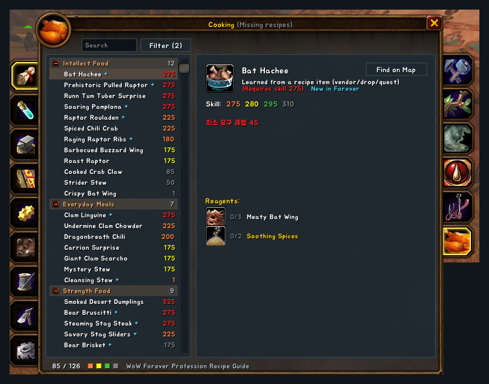
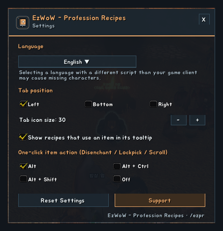
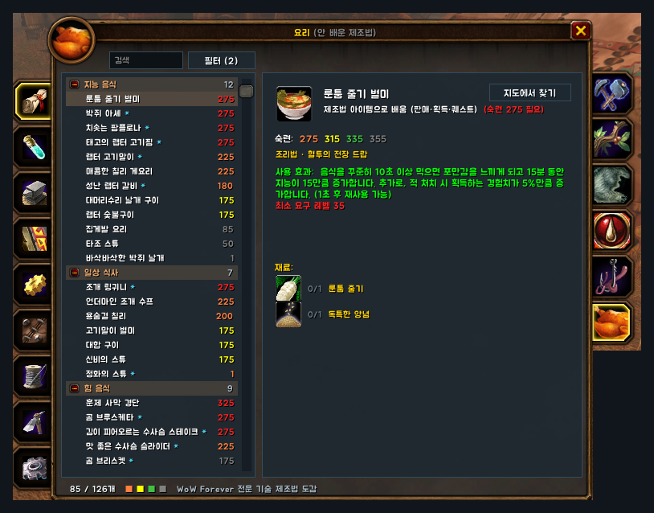
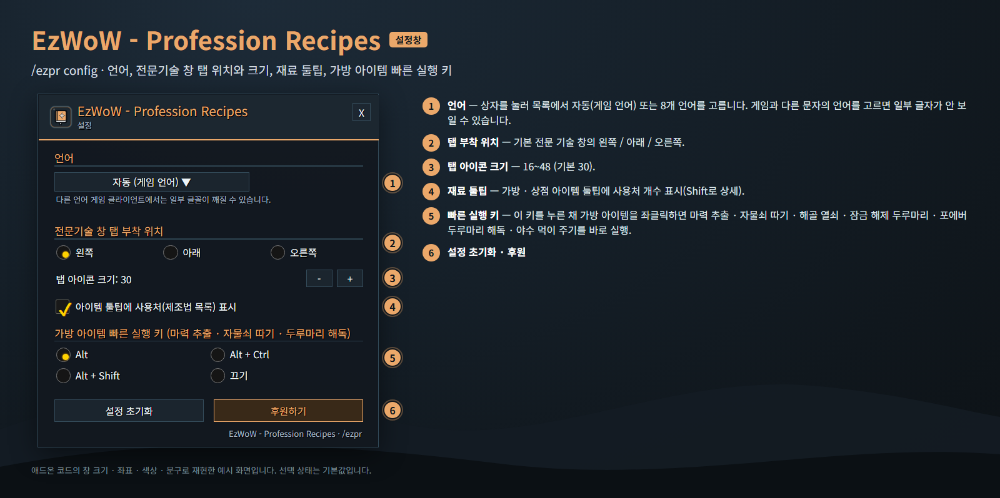

<!--
CurseForge summary (EN): A recipe book for all 12 professions with reagents, skill and where to learn, unlearned-profession tabs, reagent "used in" tooltips, recipe learned status across your characters and one-click disenchant / lockpick.
-->

# EzWoW - Profession Recipes

**English** · [한국어](#한국어)

A recipe book for WoW Forever: **12 professions and all their recipes** (camping recipes included) with reagents, skill levels and where to learn them. It adds **tabs for professions you have not learned** and a **missing-recipes tab** to the profession window, and `/ezpr` opens it on its own even if you know no profession.

*In-game screenshots with the addon set to English. The game client is Korean, so game text such as zone, item and spell names stays Korean. Character and player names and chat text are blurred.*

## Features

### Recipe window
- Alchemy, Blacksmithing, Enchanting, Engineering, Leatherworking, Tailoring, Mining (smelting), Cooking, First Aid, Herbalism, Skinning and Fishing (camp gear).
- Search by recipe name (Korean or English), reagent, zone or ID; filters for Forever-new recipes, skill 225 or less, other faction, all professions, hide learned, learnable now.
- Required skill in difficulty colours; details with skill steps, amount made, where to learn (trainers, vendors per faction with coordinates and reputation, drops, quests) and reagents, plus recipe shops and drops EzWoW users saw in the game.
- Find vendors, trainers and quests on the map with EzWoW - Map Finder (button or right-click). With coordinates you get a waypoint and a direction arrow with the seller's name; recipes with no place get their source in chat.

### Tooltips
- **Reagents**: how many recipes use the item, per profession; hold Shift for the recipe names.
- **Recipe items**: Learned / Can learn (requires skill N) / Skill too low, plus your other characters who already know it, shown as first name and surname in class colour.
- The addon name is shown once, in small grey text, under the lines it adds.

### One-click item actions (default Alt)
- Hold the key and left-click a bag item to disenchant, pick a lock, use a skeleton key or unlocking scroll, decipher a Forever scroll or feed your pet.

## Working with other EzWoW addons
- **EzWoW - Tooltip**: when this addon shows the reagent and recipe-status lines, EzWoW - Tooltip leaves out its own matching lines, so nothing shows twice.
- **EzWoW - Map Finder**: needed for Find on Map.

## Gamepad
- With the gamepad UI on, EzWoW windows work with a gamepad: D-pad to move, A (✕) to press, X (□) for right-click, LB/RB to scroll, B (○) to close. A key guide in your pad's button style shows under the window.
- With no game window open, press **View (Back) / Create** to move to the EzWoW frames on screen. Press it again or B to go back.
- To use another button: Key Bindings > AddOns > EzWoW > "Gamepad: move to / leave the EzWoW frames" (with EzWoW-MapFinder installed).

## Record sharing
- Shared by all EzWoW addons and **on by default**: quest NPCs, rare monster sightings, item drops and gathering spots you have seen yourself are shared with other EzWoW users.
- `/ezshare on` / `off`, `/ezshare channel on` / `off`, `/ezshare status`

## Commands
- `/ezpr` (`/apr`, `/제조법`, `/전문기술`) — open the recipe window
- `/ezpr config` — settings
- `/ezpr left|bottom|side` — tab position
- `/ezpr quick alt|ctrl|shift|off` — one-click action key
- `/ezpr lang auto|ko|en|de|fr|es|ru|cn|tw` — change the language
- `/ezpr reset` — reset settings (learned recipes saved per character are kept)

Languages: English, 한국어, Deutsch, Français, Español, Русский, 简体中文, 繁體中文.

---

## 한국어

WoW Forever용 제조법 도감입니다. **12개 전문 기술의 모든 제조법**(야영 제조법 포함)의 재료 · 필요 숙련도 · 배우는 곳을 보여 줍니다. 전문 기술 창 옆에 **배우지 않은 전문 기술 탭**과 **안 배운 제조법 탭**을 붙여 주고, 전문 기술이 하나도 없어도 `/ezpr`로 단독 창을 열 수 있습니다.

*실제 게임 화면입니다(WoW Forever, 한국어 클라이언트). 캐릭터 · 다른 플레이어 이름과 채팅 내용은 가렸습니다.*

## 기능

### 제조법 창
- 연금술 · 대장기술 · 마법부여 · 기계공학 · 가죽세공 · 재봉술 · 채광(제련) · 요리 · 응급치료 · 약초 채집 · 무두질 · 낚시(야영 설비).
- 한 · 영 제조법 이름, 재료, 지역, ID로 검색. 포에버 신규만 · 숙련 225 이하 · 다른 진영 숨기기 · 모든 전문 기술 검색 · 배운 것 숨기기 · 지금 배울 수 있는 것만 필터.
- 필요 숙련도를 난이도 색으로 표시하고, 숙련 단계 · 제작 수량 · 배우는 곳(전문가, 진영별 상인과 좌표 · 평판, 드랍, 퀘스트) · 재료를 자세히 보여 줍니다. EzWoW 사용자가 게임에서 확인한 도안 상점 · 드롭도 함께 나옵니다.
- EzWoW - Map Finder로 상인 · 전문가 · 퀘스트 위치를 지도에서 찾습니다(단추 또는 우클릭). 좌표가 있으면 웨이포인트와 방향 화살표(판매자 이름 표시)가 나오고, 위치가 없는 제조법은 채팅창에 획득처를 알려 줍니다.

### 툴팁
- **재료**: 그 재료를 쓰는 제조법 수를 전문 기술별로 표시하고, Shift를 누르면 제조법 이름 목록.
- **제조법 아이템**: 배움 / 배울 수 있음(숙련 N 필요) / 숙련 부족과, 이미 배운 내 다른 캐릭터를 "이름 성"(직업 색)으로 표시.
- 이 애드온이 추가한 줄 아래에 애드온 이름을 작은 회색 글씨로 한 번만 표시합니다.

### 원클릭 아이템 실행 (기본 Alt)
- 키를 누른 채 가방 아이템을 좌클릭하면 마력 추출 · 자물쇠 따기 · 해골 열쇠 · 잠금 해제 두루마리 · 포에버 두루마리 해독 · 야수 먹이 주기를 바로 실행합니다.

## 다른 EzWoW 애드온과 함께 쓰기
- **EzWoW - Tooltip**: 이 애드온이 재료 · 제조법 상태 줄을 보여 주면 EzWoW - Tooltip은 같은 줄을 생략해 두 번 나오지 않습니다.
- **EzWoW - Map Finder**: 지도에서 찾기에 필요합니다.

## 게임패드
- 게임패드 UI를 켜면 EzWoW 창을 패드로 다룰 수 있습니다. 방향키로 이동, A(✕)로 누르기, X(□)로 오른쪽 클릭, LB/RB로 스크롤, B(○)로 닫기입니다. 창 아래에 연결된 패드 모양으로 키 안내가 나옵니다.
- 블리자드 창이 열려 있지 않을 때 **보기(Back) / Create 버튼**을 누르면 화면의 EzWoW 프레임으로 이동합니다. 다시 누르거나 B를 누르면 돌아갑니다.
- 다른 버튼을 쓰려면: 설정 > 단축키 > 애드온 > EzWoW > "게임패드: EzWoW 창으로 이동/돌아가기" (EzWoW-MapFinder 설치 시)

## 기록 공유
- 모든 EzWoW 애드온이 함께 쓰며 **기본으로 켜져 있습니다**. 직접 확인한 퀘스트 NPC, 희귀 몬스터 목격, 아이템 드롭, 채집 위치를 다른 EzWoW 사용자와 나눕니다.
- `/ezshare on` / `off` (또는 `/공유`), `/ezshare channel on` / `off`, `/ezshare status`

## 명령어
- `/ezpr` (`/apr`, `/제조법`, `/전문기술`) — 제조법 창 열기
- `/ezpr config` (`설정`) — 설정창
- `/ezpr left|bottom|side` — 탭 부착 위치
- `/ezpr quick alt|ctrl|shift|off` — 빠른 실행 키
- `/ezpr lang auto|ko|en|de|fr|es|ru|cn|tw` — 언어 변경
- `/ezpr reset` — 설정 초기화(캐릭터별 배운 제조법 기록은 유지)

지원 언어: English, 한국어, Deutsch, Français, Español, Русский, 简体中文, 繁體中文.

---

**Support:** If you find this addon useful, you can support its development. [Buy Me a Coffee ☕](https://buymeacoffee.com/qqhrqqhr2)

**후원:** 애드온이 도움이 되셨다면 개발 후원으로 응원해 주세요. [Buy Me a Coffee ☕](https://buymeacoffee.com/qqhrqqhr2)
